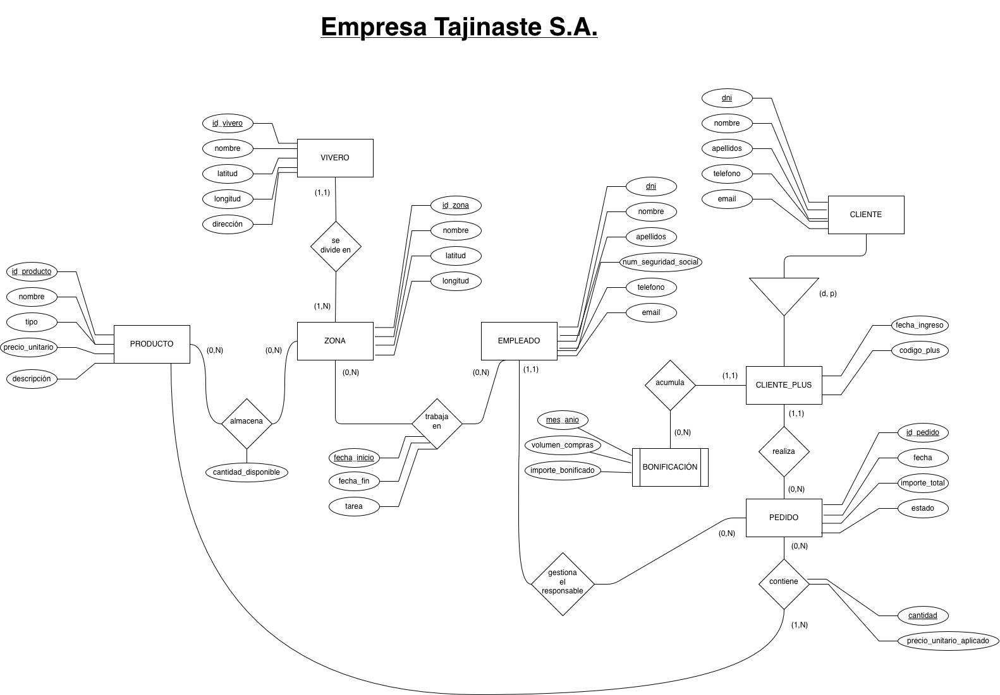
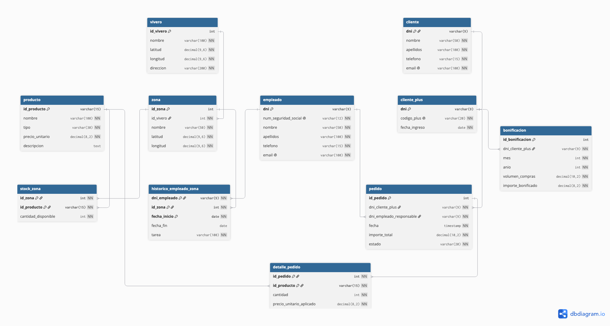

# Práctica 4: Modelo Relacional y Diseño Físico en PostgreSQL
## Tajinaste S.A. (Red de Viveros)

* **Asignatura:** Administración y Diseño de Bases de Datos (ADBD)
* **Titulación:** Grado en Ingeniería Informática — Universidad de La Laguna (ULL)
* **Curso Académico:** 2026-2027
* **Autor:** Marcos Llinares ([marcosllinares](https://github.com/marcosllinares))
* **Repositorio:** [ADBD-P4](https://github.com/marcosllinares/ADBD-P4)

---

## 1. Diagramas del Sistema

### 1.1. Modelo Entidad-Relación (Conceptual)



* 📄 **Diagrama editable:** [Descargar / Ver archivo editable draw.io (Entidad-Relacion-Viveros.drawio)](Entidad-Relacion-Viveros.drawio)

---

### 1.2. Modelo Relacional (Lógico)



---

## 2. Descripción del Proyecto y Reglas de Transformación

La empresa ficticia **Tajinaste S.A.** opera una red de viveros con zonas delimitadas, personal asignado a tareas específicas, productos clasificados, programa de fidelización de clientes (**Tajinaste Plus**) con bonificaciones mensuales y registro de pedidos gestionados por empleados.

### Reglas de Transformación de E/R a Tablas Relacionales

1. **Entidades Regulares (Fuertes):**
   * `VIVERO` $\rightarrow$ Tabla `vivero` (`id_vivero` PK).
   * `PRODUCTO` $\rightarrow$ Tabla `producto` (`id_producto` PK).
   * `EMPLEADO` $\rightarrow$ Tabla `empleado` (`dni` PK).
   * `CLIENTE` $\rightarrow$ Tabla `cliente` (`dni` PK).

2. **Relaciones 1:N (Propagación de Clave):**
   * **`vivero` (1,N) — (1,1) `zona`:** `zona` incorpora `id_vivero` como FK (`NOT NULL`) con `ON DELETE RESTRICT` y `ON UPDATE CASCADE`.
   * **`cliente_plus` (0,N) — (1,1) `pedido`:** `pedido` incorpora `dni_cliente_plus` como FK (`NOT NULL`) con `ON DELETE RESTRICT` y `ON UPDATE CASCADE`.
   * **`empleado` (0,N) — (1,1) `pedido`:** `pedido` incorpora `dni_empleado_responsable` como FK (`NOT NULL`) con `ON DELETE RESTRICT` y `ON UPDATE CASCADE`.

3. **Relaciones M:N (Tablas Asociativas):**
   * **`almacena` (`zona` $\longleftrightarrow$ `producto`):** Tabla `stock_zona` con PK compuesta `(id_zona, id_producto)` y atributo `cantidad_disponible`.
   * **`contiene` (`pedido` $\longleftrightarrow$ `producto`):** Tabla `detalle_pedido` con PK compuesta `(id_pedido, id_producto)`, y atributos `cantidad` y `precio_unitario_aplicado`.
   * **`trabaja en` (`empleado` $\longleftrightarrow$ `zona`):** Tabla histórica `historico_empleado_zona` con PK compuesta `(dni_empleado, id_zona, fecha_inicio)`, permitiendo registrar múltiples destinos a lo largo del tiempo.

4. **Jerarquía de Especialización (`cliente` $\rightarrow$ `cliente_plus`):**
   * Se utiliza el método de tablas separadas. `cliente` contiene los datos genéricos de todo comprador registrado y `cliente_plus` contiene los datos exclusivos de fidelización, teniendo como PK su propio `dni`, que actúa simultáneamente como FK hacia `cliente(dni)` con `ON DELETE CASCADE`.

5. **Entidad Débil (`bonificacion`):**
   * Depende por identificación de `cliente_plus`. Se modela con clave técnica autoincremental `id_bonificacion` y una restricción `UNIQUE (dni_cliente_plus, mes, anio)`, vinculada con `ON DELETE CASCADE`.

---

## 3. Diccionario de Datos y Restricciones de Integridad

El esquema físico en PostgreSQL incorpora 15 restricciones de tipo `CHECK`, unicidades y validaciones de rango:

| Tabla | Clave Primaria (PK) | Claves Foráneas (FK) | Restricciones `CHECK` y Unicidad |
| :--- | :--- | :--- | :--- |
| **`vivero`** | `id_vivero` | — | Coordenadas: `latitud BETWEEN -90 AND 90`, `longitud BETWEEN -180 AND 180`. |
| **`zona`** | `id_zona` | `id_vivero` $\rightarrow$ `vivero` | Coordenadas: `latitud BETWEEN -90 AND 90`, `longitud BETWEEN -180 AND 180`. |
| **`producto`** | `id_producto` | — | `precio_unitario >= 0.00`, `tipo IN ('Planta', 'Jardinería', 'Decoración')`. |
| **`stock_zona`** | `(id_zona, id_producto)` | `id_zona` $\rightarrow$ `zona`<br>`id_producto` $\rightarrow$ `producto` | `cantidad_disponible >= 0`. |
| **`empleado`** | `dni` | — | `UNIQUE(num_seguridad_social)`, `UNIQUE(email)`. |
| **`historico_empleado_zona`** | `(dni_empleado, id_zona, fecha_inicio)` | `dni_empleado` $\rightarrow$ `empleado`<br>`id_zona` $\rightarrow$ `zona` | `fecha_fin IS NULL OR fecha_fin >= fecha_inicio`. |
| **`cliente`** | `dni` | — | `UNIQUE(email)`. |
| **`cliente_plus`** | `dni` | `dni` $\rightarrow$ `cliente` | `UNIQUE(codigo_plus)`. |
| **`bonificacion`** | `id_bonificacion` | `dni_cliente_plus` $\rightarrow$ `cliente_plus` | `mes BETWEEN 1 AND 12`, `volumen_compras >= 0.00`, `importe_bonificado >= 0.00`, `UNIQUE(dni_cliente_plus, mes, anio)`. |
| **`pedido`** | `id_pedido` | `dni_cliente_plus` $\rightarrow$ `cliente_plus`<br>`dni_empleado_responsable` $\rightarrow$ `empleado` | `importe_total >= 0.00`, `estado IN ('Pendiente', 'Completado', 'Cancelado')`. |
| **`detalle_pedido`** | `(id_pedido, id_producto)` | `id_pedido` $\rightarrow$ `pedido`<br>`id_producto` $\rightarrow$ `producto` | `cantidad > 0`, `precio_unitario_aplicado >= 0.00`. |

---

## 4. Gestión de Atributos Derivados (Calculados)

En PostgreSQL, las columnas generadas (`GENERATED ALWAYS AS ... STORED`) no permiten subconsultas ni funciones de agregación entre múltiples tablas. Para modelar los atributos calculados del modelo E/R se implementaron dos soluciones:

### 4.1. `PEDIDO.importe_total` (Trigger y Función PL/pgSQL)

El importe total de un pedido se mantiene automáticamente sincronizado ante cualquier inserción, modificación o borrado en `detalle_pedido`:

```sql
CREATE OR REPLACE FUNCTION fn_actualizar_importe_pedido()
RETURNS TRIGGER AS $$
DECLARE
  v_id_pedido int;
BEGIN
  v_id_pedido := COALESCE(NEW.id_pedido, OLD.id_pedido);
  
  UPDATE pedido
  SET importe_total = COALESCE((
    SELECT SUM(cantidad * precio_unitario_aplicado)
    FROM detalle_pedido
    WHERE id_pedido = v_id_pedido
  ), 0.00)
  WHERE id_pedido = v_id_pedido;
  
  RETURN NULL;
END;
$$ LANGUAGE plpgsql;

CREATE TRIGGER trg_actualizar_importe_pedido
AFTER INSERT OR UPDATE OR DELETE ON detalle_pedido
FOR EACH ROW
EXECUTE FUNCTION fn_actualizar_importe_pedido();
```

### 4.2. `BONIFICACION.volumen_compras` (Vista Analítica Dinámica)

Se proporciona la vista `vista_calculo_bonificaciones_mensuales` para computar en tiempo real el volumen mensual de compras y el cálculo del 5% de bonificación sobre pedidos en estado `Completado`:

```sql
CREATE OR REPLACE VIEW vista_calculo_bonificaciones_mensuales AS
SELECT 
  p.dni_cliente_plus,
  EXTRACT(MONTH FROM p.fecha)::int AS mes,
  EXTRACT(YEAR FROM p.fecha)::int AS anio,
  SUM(p.importe_total) AS volumen_compras_real,
  ROUND(SUM(p.importe_total) * 0.05, 2) AS bonificacion_5_porciento
FROM pedido p
WHERE p.estado = 'Completado'
GROUP BY p.dni_cliente_plus, EXTRACT(YEAR FROM p.fecha), EXTRACT(MONTH FROM p.fecha);
```

---

## 5. Salidas de las Consultas (`SELECT *` de cada tabla)

A continuación se presentan las salidas reales obtenidas tras la ejecución del script de consulta `consultar_tablas.sh` sobre la base de datos `viveros`. Cada tabla cuenta con $\ge 5$ registros cubriendo todos los escenarios operativos requeridos:

### 5.1. Tabla `vivero`
```
 id_vivero |           nombre           |  latitud  |  longitud  |                   direccion                   
-----------+----------------------------+-----------+------------+-----------------------------------------------
         1 | Vivero Tacoronte Norte     | 28.481234 | -16.415678 | Carretera General del Norte, km 15, Tacoronte
         2 | Vivero Valle de La Orotava | 28.391100 | -16.523400 | Camino El Bosque 12, La Orotava
         3 | Vivero Costa Adeje         | 28.125600 | -16.732100 | Avenida de los Viveros 4, Adeje
         4 | Vivero Candelaria Sur      | 28.354100 | -16.371200 | Calle Las Caletillas 8, Candelaria
         5 | Vivero San Cristóbal       | 28.487600 | -16.315400 | Camino San Lázaro 45, La Laguna
(5 rows)
```

### 5.2. Tabla `zona`
```
 id_zona | id_vivero |               nombre                |  latitud  |  longitud  
---------+-----------+-------------------------------------+-----------+------------
     101 |         1 | Zona Exterior Plantas Autóctonas    | 28.481300 | -16.415710
     102 |         1 | Almacén Central Tacoronte           | 28.481210 | -16.415650
     201 |         2 | Invernadero Climatizado Flores      | 28.391150 | -16.523450
     301 |         3 | Exposición Plantas Tropicales       | 28.125650 | -16.732150
     401 |         4 | Zona Venta y Decoración Exterior    | 28.354150 | -16.371250
     501 |         5 | Almacén de Herramientas y Sustratos | 28.487650 | -16.315450
(6 rows)
```

### 5.3. Tabla `producto`
```
 id_producto  |                nombre                 |    tipo    | precio_unitario |                         descripcion                          
--------------+---------------------------------------+------------+-----------------+--------------------------------------------------------------
 PRD-PLANT-01 | Drago Canario (Dracaena draco)        | Planta     |           28.50 | Ejemplar joven en maceta de 25 cm, especie autóctona
 PRD-PLANT-02 | Palmera Canaria (Phoenix canariensis) | Planta     |           45.00 | Palmera canaria de 1 metro de altura, adaptada a exterior
 PRD-JARD-01  | Tijeras de Podar Ergonómicas Pro      | Jardinería |           18.75 | Tijeras de acero inoxidable con mango antideslizante
 PRD-JARD-02  | Sustrato Universal Volcánico 50L      | Jardinería |            9.20 | Sustrato enriquecido con picón volcánico y materia orgánica
 PRD-DECO-01  | Maceta Artesanal de Barro 40cm        | Decoración |           22.00 | Maceta de barro cocido hecha a mano, resistente a intemperie
 PRD-DECO-02  | Farol Solar LED de Jardín             | Decoración |           14.50 | Luminaria solar estanca para caminos y zonas exteriores
(6 rows)
```

### 5.4. Tabla `stock_zona`
```
 id_zona | id_producto  | cantidad_disponible 
---------+--------------+---------------------
     101 | PRD-PLANT-01 |                  35
     101 | PRD-PLANT-02 |                  15
     102 | PRD-JARD-02  |                 120
     201 | PRD-PLANT-01 |                  20
     301 | PRD-DECO-01  |                  40
     401 | PRD-DECO-02  |                  60
     501 | PRD-JARD-01  |                  85
(7 rows)
```

### 5.5. Tabla `empleado`
```
    dni    | num_seguridad_social |  nombre   |    apellidos    |   telefono   |          email           
-----------+----------------------+-----------+-----------------+--------------+--------------------------
 42345678Z | 381234567890         | Laura     | García Ramos    | +34600123456 | lgarcia@tajinaste.com
 43876543Y | 381234567891         | Alejandro | Hernández Pérez | +34611234567 | ahernandez@tajinaste.com
 78901234X | 381234567892         | Marta     | González Dorta  | +34622345678 | mgonzalez@tajinaste.com
 54123987W | 381234567893         | Carlos    | Mendoza Afonso  | +34633456789 | cmendoza@tajinaste.com
 45678912V | 381234567894         | Elena     | Brito Cabrera   | +34644567890 | ebrito@tajinaste.com
(5 rows)
```

### 5.6. Tabla `historico_empleado_zona`
```
 dni_empleado | id_zona | fecha_inicio | fecha_fin  |                         tarea                         
--------------+---------+--------------+------------+-------------------------------------------------------
 42345678Z    |     101 | 2023-01-10   | 2023-06-30 | Encargada de riego y aclimatación de planta autóctona
 42345678Z    |     102 | 2023-07-01   |            | Gestión de logística y stock en almacén central
 43876543Y    |     201 | 2023-03-15   |            | Control de clima y floración en invernadero
 78901234X    |     301 | 2023-02-01   | 2023-12-31 | Asesoramiento técnico y venta directa de tropicales
 78901234X    |     401 | 2024-01-01   |            | Atención comercial y asesoría en decoración
 54123987W    |     501 | 2023-05-01   |            | Recepción de mercancías y preparación de pedidos
 45678912V    |     101 | 2023-09-01   |            | Mantenimiento de zonas exteriores y poda de temporada
(7 rows)
```

### 5.7. Tabla `cliente`
```
    dni    |  nombre  |    apellidos    |   telefono   |         email          
-----------+----------+-----------------+--------------+------------------------
 78912345T | Carlos   | Martín Pérez    | +34677987654 | cmartin@gmail.com
 43567890R | Beatriz  | López Santana   | +34688112233 | blopez@hotmail.com
 54231987P | Diego    | Navarro Curbelo | +34699445566 | dnavarro@yahoo.es
 78654321M | Silvia   | Rodríguez Mesa  | +34670223344 | srodriguez@gmail.com
 42112233K | Javier   | Domínguez León  | +34680334455 | jdominguez@outlook.com
 55667788S | Patricia | Herrera Vega    | +34690445566 | pherrera@gmail.com
(6 rows)
```

### 5.8. Tabla `cliente_plus`
```
    dni    | codigo_plus  | fecha_ingreso 
-----------+--------------+---------------
 78912345T | PLS-2023-001 | 2023-02-15
 43567890R | PLS-2023-045 | 2023-04-10
 54231987P | PLS-2023-112 | 2023-07-01
 78654321M | PLS-2024-019 | 2024-01-20
 42112233K | PLS-2024-088 | 2024-03-05
(5 rows)
```

### 5.9. Tabla `bonificacion`
```
 id_bonificacion | dni_cliente_plus | mes | anio | volumen_compras | importe_bonificado 
-----------------+------------------+-----+------+-----------------+--------------------
               1 | 78912345T        |   3 | 2024 |          345.50 |              17.28
               2 | 78912345T        |   4 | 2024 |          520.00 |              26.00
               3 | 43567890R        |   3 | 2024 |          185.00 |               9.25
               4 | 54231987P        |   4 | 2024 |          410.20 |              20.51
               5 | 78654321M        |   4 | 2024 |           98.00 |               4.90
(5 rows)
```

### 5.10. Tabla `pedido`
```
 id_pedido | dni_cliente_plus | dni_empleado_responsable |        fecha        | importe_total |   estado   
-----------+------------------+--------------------------+---------------------+---------------+------------
      1001 | 78912345T        | 42345678Z                | 2024-03-10 10:30:00 |        102.00 | Completado
      1002 | 43567890R        | 78901234X                | 2024-03-18 12:15:00 |         89.50 | Completado
      1003 | 78912345T        | 42345678Z                | 2024-04-05 16:45:00 |        135.00 | Completado
      1004 | 54231987P        | 43876543Y                | 2024-04-12 11:20:00 |         45.00 | Pendiente
      1005 | 42112233K        | 78901234X                | 2024-04-20 09:50:00 |         58.75 | Cancelado
      1006 | 78654321M        | 42345678Z                | 2024-04-22 17:10:00 |         98.00 | Completado
(6 rows)
```

### 5.11. Tabla `detalle_pedido`
```
 id_pedido | id_producto  | cantidad | precio_unitario_aplicado 
-----------+--------------+----------+--------------------------
      1001 | PRD-PLANT-01 |        2 |                    28.50
      1001 | PRD-DECO-01  |        2 |                    22.50
      1002 | PRD-JARD-01  |        2 |                    18.75
      1002 | PRD-DECO-01  |        2 |                    26.00
      1003 | PRD-PLANT-02 |        3 |                    45.00
      1004 | PRD-PLANT-02 |        1 |                    45.00
      1005 | PRD-JARD-01  |        1 |                    18.75
      1005 | PRD-DECO-01  |        1 |                    22.00
      1005 | PRD-JARD-02  |        2 |                     9.00
      1006 | PRD-PLANT-01 |        2 |                    28.50
      1006 | PRD-DECO-02  |        2 |                    14.50
      1006 | PRD-JARD-02  |        1 |                    12.00
(12 rows)
```

### 5.12. Vista Analítica `vista_calculo_bonificaciones_mensuales`
```
 dni_cliente_plus | mes | anio | volumen_compras_real | bonificacion_5_porciento 
------------------+-----+------+----------------------+--------------------------
 43567890R        |   3 | 2024 |                89.50 |                     4.48
 78654321M        |   4 | 2024 |                98.00 |                     4.90
 78912345T        |   3 | 2024 |               102.00 |                     5.10
 78912345T        |   4 | 2024 |               135.00 |                     6.75
(4 rows)
```

---

## 6. Demostración de Integridad Referencial y Operaciones DELETE

### 6.1. Ejemplo 1: Borrado en Cascada (`ON DELETE CASCADE`)
* **Escenario:** Al eliminar un pedido, todas sus líneas asociadas en `detalle_pedido` deben suprimirse automáticamente sin dejar registros huérfanos.
* **Demostración:** Se inserta el pedido temporal `9999` con dos líneas de detalle y se elimina:
```sql
INSERT INTO pedido (id_pedido, dni_cliente_plus, dni_empleado_responsable, fecha, estado)
VALUES (9999, '78912345T', '42345678Z', '2024-05-01 10:00:00', 'Pendiente');

INSERT INTO detalle_pedido (id_pedido, id_producto, cantidad, precio_unitario_aplicado)
VALUES 
  (9999, 'PRD-PLANT-01', 1, 28.50),
  (9999, 'PRD-DECO-01', 1, 22.00);

DELETE FROM pedido WHERE id_pedido = 9999;
-- Comprobación: SELECT * FROM detalle_pedido WHERE id_pedido = 9999; devuelve 0 filas.
```

### 6.2. Ejemplo 2: Integridad Restrictiva (`ON DELETE RESTRICT`)
* **Escenario:** Si se intenta eliminar un vivero que posee zonas operativas asignadas, PostgreSQL debe abortar la operación bloqueando el borrado para evitar inconsistencias en cascada en la infraestructura física.
* **Prueba en terminal interactiva `psql`:**
```
viveros=# DELETE FROM vivero WHERE id_vivero = 1;
ERROR:  update or delete on table "vivero" violates RESTRICT setting of foreign key constraint "fk_zona_vivero" on table "zona"
DETAIL:  Key (id_vivero)=(1) is referenced from table "zona".
```

### 6.3. Ejemplo 3: Borrado en Jerarquía y Entidad Débil (`ON DELETE CASCADE`)
* **Escenario:** Cuando un cliente general se da de baja, se eliminan en cascada sus registros dependientes en `cliente_plus` y sus bonificaciones acumuladas en `bonificacion`:
```sql
INSERT INTO cliente (dni, nombre, apellidos, telefono, email)
VALUES ('99999999K', 'Cliente', 'Temporal Borrado', '+34699999999', 'temp@tajinaste.com');

INSERT INTO cliente_plus (dni, codigo_plus, fecha_ingreso)
VALUES ('99999999K', 'PLS-TEMP-99', '2024-01-01');

INSERT INTO bonificacion (dni_cliente_plus, mes, anio, volumen_compras, importe_bonificado)
VALUES ('99999999K', 1, 2024, 100.00, 5.00);

DELETE FROM cliente WHERE dni = '99999999K';
-- Comprobación: Tanto cliente_plus como bonificacion para '99999999K' devuelven 0 filas.
```

---

## 7. Instrucciones de Despliegue y Ejecución

### 7.1. Prerrequisitos
* PostgreSQL 14+ (probado en PostgreSQL 18.6 Homebrew en macOS).
* Cliente de terminal `psql`.

### 7.2. Ejecución del Script Principal
Para crear la base de datos `viveros`, construir las tablas, triggers, restricciones y cargar los datos de prueba:
```bash
psql postgres -f viveros.sql
```

### 7.3. Comprobación de Tablas
Para visualizar de forma ordenada el contenido de todas las tablas:
```bash
chmod +x consultar_tablas.sh
./consultar_tablas.sh
```
